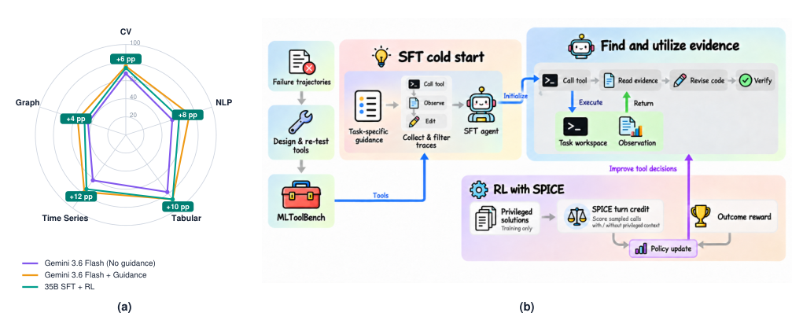
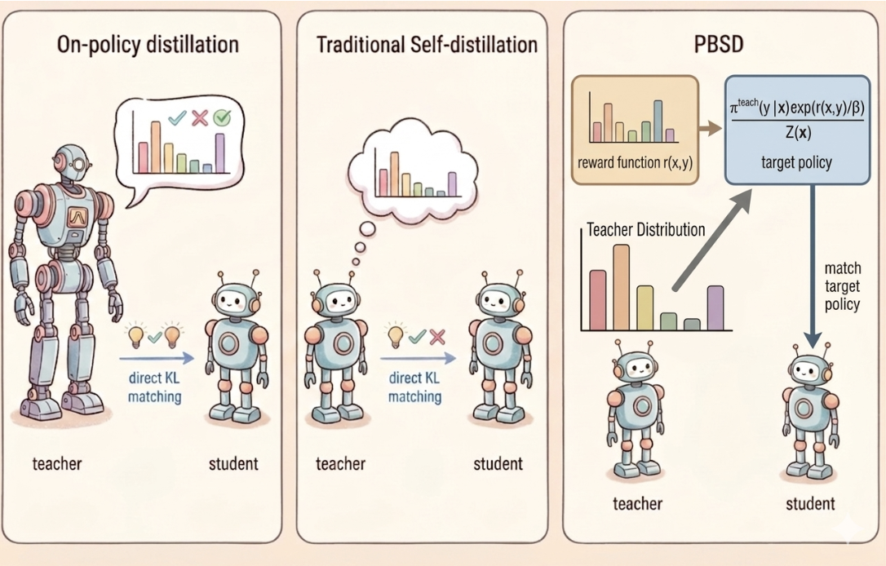
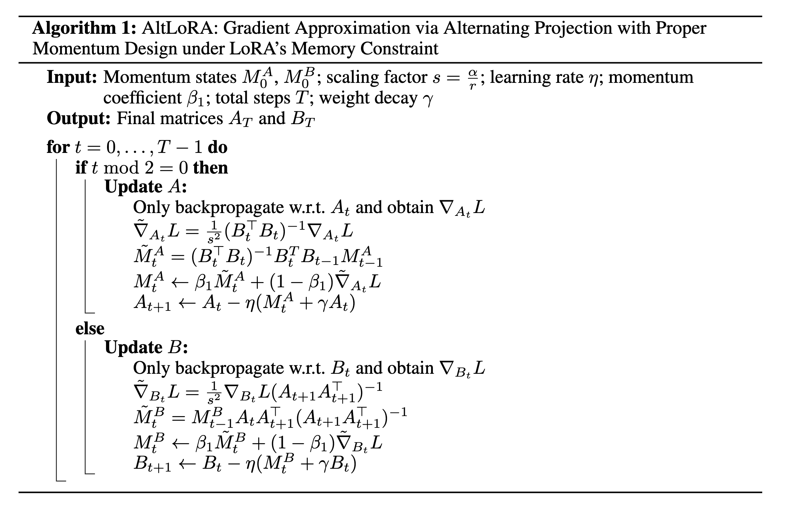
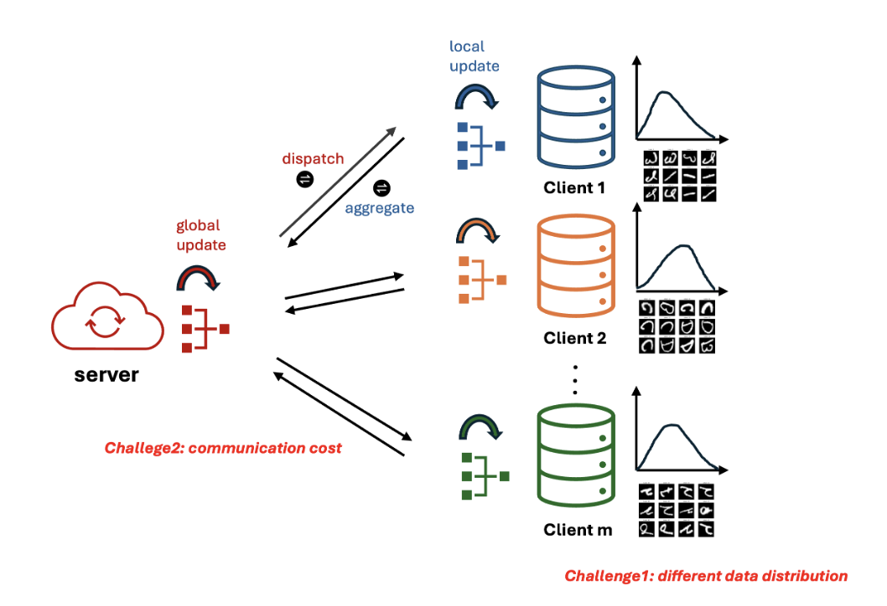

# Xin (Lucas) Yu

**Ph.D. Candidate in Statistics · Penn State** &nbsp; | &nbsp; **Student Researcher · Google**

  
  
  
  
  

I work on **post-training for language-model agents**: helping models reason, use tools, and improve through feedback. My research connects agentic reinforcement learning, distillation, efficient adaptation, and generative recommendation, with a foundation in statistical machine learning.

At Penn State, I am advised by [Prof. Lingzhou Xue](https://lingzhou-xue.github.io/).

## Research interests

- **Agents & reinforcement learning** — coding agents, tool use, and recursive self-improvement.
- **Distillation & efficient post-training** — preference learning, self-distillation, and low-rank adaptation.
- **Generative modeling & recommendation** — multimodal understanding and preference optimization.
- **Statistical machine learning** — generalization, robustness, and personalized federated learning.

## Selected research

<table>
<tr>
<td width="50%" valign="top">

<h3>MLToolBench</h3>

<strong>Tool-augmented agents for ML development</strong> Learning to find and use diagnostic evidence through supervised fine-tuning and reinforcement learning.

arXiv · 2026 <a href="https://arxiv.org/abs/2609.36679">Paper ↗</a>

</td>
<td width="50%" valign="top">

<h3>PBSD</h3>

<strong>Preference-based self-distillation</strong> Moving beyond KL matching with reward regularization for language-model post-training.

arXiv · 2026 <a href="https://arxiv.org/abs/2605.05040">Paper ↗</a> &nbsp;·&nbsp; <a href="https://github.com/LucasXinYu/PBSD">Code ↗</a>

</td>
</tr>
<tr>
<td width="50%" valign="top">

<h3>AltLoRA</h3>

<strong>Efficient low-rank adaptation</strong> Alternating projections for better gradient approximation while preserving memory efficiency.

NeurIPS · 2025 <a href="https://arxiv.org/abs/2505.12455">Paper ↗</a> &nbsp;·&nbsp; <a href="https://github.com/LucasXinYu/AltLoRA">Code ↗</a>

</td>
<td width="50%" valign="top">

<h3>FedCLUP</h3>

<strong>Personalized federated learning</strong> Understanding the statistical accuracy–communication trade-off with minimax guarantees.

ICML · 2025 <a href="https://arxiv.org/abs/2410.08934">Paper ↗</a> &nbsp;·&nbsp; <a href="https://github.com/LucasXinYu/FedCLUP">Code ↗</a>

</td>
</tr>
</table>

**Also at ICLR 2026:** [Towards Better Optimization For Listwise Preference in Diffusion Models](https://arxiv.org/abs/2510.01540) · [Code](https://github.com/jiamubai/personalized-diffusion-listwise-dpo)

[Full publication list →](https://scholar.google.com/citations?user=YMauDFsAAAAJ&hl=en)

## Industry experience

<table>
<tr><th></th><th align="left">Role &amp; dates</th><th align="left">Research focus</th></tr>
<tr>
<td align="center" width="72"></td>
<td><strong>Google</strong> Student Researcher Aug. 2026 – Present · Sunnyvale, CA</td>
<td>Coding agents Agent post-training Recursive self-improvement</td>
</tr>
<tr>
<td align="center"></td>
<td><strong>Meta · Feed Discovery</strong> Research Scientist Intern May 2026 – Aug. 2026 · Menlo Park, CA</td>
<td>Generative recommendation Tool-augmented agents Agentic RL / GRPO</td>
</tr>
<tr>
<td align="center"></td>
<td><strong>TikTok · Ads Integrity</strong> Research Scientist Intern Nov. 2025 – May 2026 · San Jose, CA</td>
<td>Multimodal understanding Self-rewarding On-policy distillation</td>
</tr>
<tr>
<td align="center"></td>
<td><strong>ByteDance · Seed</strong> Research Scientist Intern May 2025 – Dec. 2025 · Seattle, WA</td>
<td>Efficient RL training VERL / FSDP / GRPO Diffusion preference optimization</td>
</tr>
<tr>
<td align="center"></td>
<td><strong>Microsoft Research Asia</strong> Intelligent Multimedia Group Intern Jan. 2023 – May 2023 · Beijing, China</td>
<td>Efficient vision models Imbalanced learning OCR</td>
</tr>
</table>

## Recent updates

- **Sep. 2026** — [MLToolBench](https://arxiv.org/abs/2609.36679): learning tool-augmented agents for machine learning development.
- **Aug. 2026** — Joined Google as a Student Researcher, working on coding agents and agent post-training.

## Education & community

**Penn State** — Ph.D. in Statistics, ongoing; M.S., 2025. 
**Nankai University** — B.S. in Statistics, 2023.

I also contribute through peer review, teaching, and statistical consulting. See my [homepage](https://lucasxinyu.github.io/) for service, the full CV, and more about my work.
